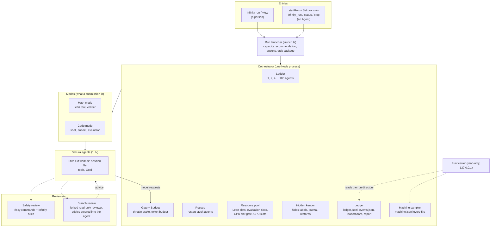
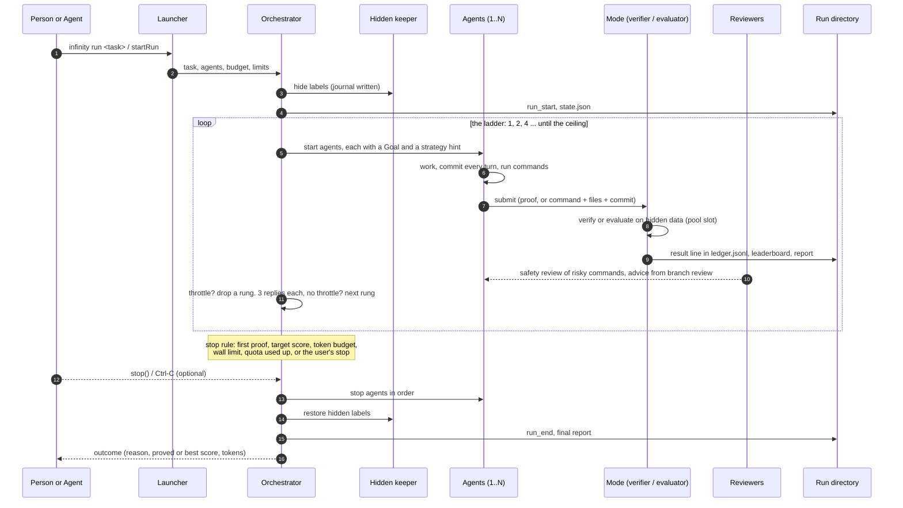

# infinity-agent (working name)

Run many agents (1 to 100) in parallel on one task and rank what they produce. Built on the [Sakura agent framework](https://www.npmjs.com/package/sakura-agent). A task is a small TypeScript package; one command (`infinity run <task>`) or one library call (`startRun`) runs it. It runs on the machine where it is started; for a remote machine, install and run it there.

Two kinds of task are built:

- **math** (`mode: "math"`): agents try to prove one statement in Lean 4; the run ends at the first proof that the local Lean accepts.
- **code** (`mode: "code"`): every agent has a shell and a `submit` tool; each submit is scored by your evaluator on data the agents cannot see (machine-learning tasks, for example `tasks/covertype/`).

Status: both modes work with scripted models (`npm test`) and with a real model. Known limits are listed at the end of the next section.

## Architecture

### Components



The launcher turns the caller's choices and the machine's capacity into one task and starts the orchestrator; both entries use the same code. The orchestrator owns everything that is shared by all agents: how many live (ladder), the brake on model requests (gate), the token budget, the pools that limit heavy work, the hidden data, and the records. A mode defines what a submission is and how it is judged; the agents are Sakura agents, each in its own Git work directory. Reviewers and the viewer are optional parts: the viewer only reads the files of the run and never controls it.

### One run



A run starts by hiding the labels, then raises the number of live agents rung by rung while the provider does not throttle. Every submission is checked by the mode (Lean for math, your evaluator for code) and written to the ledger, which feeds the leaderboard and the report. The run ends by a stop rule or by the user; the agents are stopped, the labels are put back, and the final report is written.

## How to run a test

All commands are run in the `infinity-agent/` directory.

### 1. Install

You need Node 24 or newer and git. For math tasks you need Lean 4 (`curl https://elan.lean-lang.org/elan-init.sh -sSf | sh`; the program checks `lean --version` and `lake --version` at start and prints this command if they are missing; Mathlib is not needed). For the code task you need Python 3 with numpy, pandas and scikit-learn.

```sh
npm install --min-release-age=0     # the flag is only needed where npm refuses very new packages
npm run check                        # types, lint, format, tests (about 3 minutes); optional
```

### 2. Configure the model

The model is DeepSeek through a provider; the key is read from the environment once, removed from it, and never printed or written.

```sh
export OPENCODE_API_KEY=...                                  # default provider (OpenCode Go)
# or, when that quota is used up:
export INFINITY_PROVIDER=commandcode COMMANDCODE_API_KEY=... # Command Code
```

### 3. Run a math task

```sh
node bin/infinity.ts run math-parity --agents 3 --view      # prove "n % 2 = 0 or n % 2 = 1"; ends at the first accepted proof
node bin/infinity.ts run math-odd-sum --agents 10 --view     # needs induction
```

A real run with one agent proved `math-parity` in about 20 seconds for about 9,000 tokens. Your own statement: copy `tasks/math-parity/task.ts` and `tasks/math-task.ts` and change the statement.

### 4. Run a code task

```sh
python3 -m venv .venv-ml && .venv-ml/bin/pip install numpy pandas scikit-learn
.venv-ml/bin/python tasks/covertype/prepare.py 150000        # once; a sample of the data (no number = all 581,012 rows)
PATH="$PWD/.venv-ml/bin:$PATH" node bin/infinity.ts run covertype --agents 2 --tokens 1000000 --wall-minutes 20 --view
```

Covertype asks the agents to predict the forest cover type (7 classes); the score is accuracy on hidden labels. Start small, and use the sample: on a laptop, 2 agents on the full data had no scored submission after 20 minutes (training is slow and one CPU slot is shared), so expect the first scores later than in the math task. Flags: `node bin/infinity.ts --help` (conflicting flags are refused with a message). `--agents N` always wins over the machine's recommendation, which is printed first. `--no-review` leaves the branch review out (it can be about half of the tokens). A new task is one file that exports a task package (`name`, `summary`, `profile`, `defaults`, `build(context)`): see `tasks/covertype/task.ts`, then `infinity run ./my-task.ts`.

### 5. Open the viewer

`--view` serves a read-only page at `http://127.0.0.1:4173/` (`--view-port N` changes it; the address is printed). It shows the rungs, scored submissions with the best-so-far line, the machine, the agents, the reviews and the leaderboard. It has no dependencies, binds to `127.0.0.1` only, answers GET only and never writes into a run. On its own, for a running or finished run (or a directory of runs, newest first):

```sh
node bin/infinity.ts view runs
```

On a remote machine forward the port yourself (`ssh -L 4173:127.0.0.1:4173 host`).

### 6. Read the results

Each run writes `runs/<task>-<time>/`:

| File | What it holds |
|---|---|
| `report/report.html` | leaderboard, score over time, reviews, warnings; rewritten at each rung change and at the end |
| `report/leaderboard.csv` | one row per scored result: agent, score, commit, work directory |
| `ledger.jsonl` | what each agent did; `result` lines are submissions |
| `events.jsonl` | rungs, throttles, reviews, refusals, warnings, `run_end` |
| `machine.jsonl` | machine readings every 5 s (Linux only) |
| `run-facts.json`, `state.json` | the command line and the facts of the run; the state for resuming |
| `agents/NNN/work/` | one Git repository per agent, a commit after every turn; the best solution is the commit named in the first row of the leaderboard (`git show <commit>`) |

The last line printed is the outcome, for example `{"reason":"proved","proved":[1],"tokensUsed":8781}`. Check that no key is in the run: `grep -rlF -- "$OPENCODE_API_KEY" runs/<run> | wc -l` must print 0.

### 7. Stop and resume

- **Stop:** Ctrl-C (the run ends in order: agents stopped, report written, hidden labels put back), `--wall-minutes N`, the token cap `--tokens N`, or `stop()` from the library.
- **Resume:** `node bin/infinity.ts run covertype --resume runs/<run> <the same flags>` continues with the same agents where they were.
- After a hard kill (`kill -9`, power loss) put hidden labels back first: `node examples/recover-hidden.ts runs/<run>/.keeper`.

### 8. Use it as an Agent

```ts
import { startRun } from "./src/launch.ts";
import { createInfinityTools } from "./src/sakura-tools.ts";
import covertype from "./tasks/covertype/task.ts";

const run = await startRun(covertype, { model, agents: 8, wallMinutes: 45 });   // returns at once; the run goes on in this process
console.log(run.runDir, run.recommendation.lines);
console.log(run.status());                    // read from the run's files: state, agents alive, tokens, best score
console.log(run.events().events.slice(-3));   // the newest events; run.events(next) gives only what is new
await run.stop();                             // ends the run in order and waits (run.done settles on its own too)

const tools = createInfinityTools({ packs: [covertype], model });   // infinity_run, infinity_status, infinity_stop for a Sakura agent
```

### Known limits

- **The run side needs Linux for full function.** On macOS a run works, but machine readings, limits on commands and the cleanup of leftover processes are unsupported; the report and events say so in a warning. The recommended agent count there is only a hint.
- **No sandbox.** Lean proof files and the code that agents run have your user's rights, network included. The review and the rules lower the risk and prove nothing. Run on a machine you can afford to lose files on, not on one with secrets in the home directory.
- **Hidden labels are not blocked at the operating-system level.** They are moved to an unguessable private path during the run and restored at the end; the agents' shell can read files your user can read (`ShellGuard` is planned, not built).
- **Provider quota.** A throttling answer drops one rung; when the quota is used up the run stops. A very long provider wait (days) is treated as a quota end.
- **Not verified:** runs above 8 agents on this Mac, any real run without scripted help on a machine other than the owner's Mac and server, GPU pools on real hardware (a fake `nvidia-smi` is tested), a real run where nobody proves it, and the benefit of the branch review (not measured; it costs tokens).
- **One flaky test:** `test/scale-code.test.ts` compares real timings and can fail when the machine is busy; it passes alone.

## Lean and the sandbox

- Math mode needs `lean` and `lake` on the PATH. Mathlib is optional and is checked at start only when a task asks for it.
- **Without the sandbox, a proof file is a program that runs with your rights.** Lean runs code at compile time (`#eval`, macros, `initialize`). The owner decided that there is no sandbox by default. Instead: the Lean process gets a clean environment (only PATH, HOME, LEAN_PATH; no keys), the agents have no shell and their file tools are confined to their work directory, and a deny-list rejects `#eval`, macros, `elab`, `initialize`, `unsafe`, `extern` and other imports at `submit` (it is not a boundary).
- `sandbox: true` in a task confines every Lean process on macOS with `sandbox-exec`. There is no sandbox on Linux in this version.
- The official check accepts a proof only if it compiles, has no `sorry`, depends only on `propext`, `Classical.choice`, `Quot.sound`, and `theorem main` has exactly the type `Statement.Goal`.
- Every agent is started with a **Goal**; for math the check is `test -f ../proved`, a marker that only the orchestrator writes when the verifier has accepted a proof.

## Code mode

Every agent has `read`, `write`, `edit`, `bash` and `submit`; the submit is command + listed files + commit, scored by your evaluator on data the agents cannot see. A deployment can supply a Sakura tool environment through `INFINITY_WORKER_ENVIRONMENT` or `runTask(..., { createEnvironment })` to control shell access and accelerators.

- **Branch review (optional):** every few minutes each agent's conversation is forked; a reviewer with the same model, system text and tools (so the provider's cache applies) may only `read` files in the agent's directory and says `OK` or gives short advice, which is steered into the agent marked as not coming from the user. It is not a gatekeeper and its benefit is not measured. It costs tokens: in the one real run, reviews were about half of the tokens counted.
- **Safety review (`review`):** the framework's review plugin judges risky commands; in front of it Infinity's rules refuse pushing, ssh, uploads, killing by name, credential files, the hidden data, other agents' directories and the run's own files. `review: false` switches it off and the report says so.
- **Hidden data:** moved away with a journal while the agents run and put back at the end (also on Ctrl-C and on a crash). The evaluator gets the private path. Even with a profile, the evaluator must not return hidden labels in its answer, and a hidden split that can be recomputed from public data is not hidden (covertype is public: the task forbids looking it up, which the rules and the reviewer enforce only as far as they notice).
- The number of agents is yours to choose; the report only gives a hint.

Tests: `npm test` (about 3 minutes; uses real Lean when it is installed), `npm run check` (types, lint, format, tests), `npm run coverage`.
